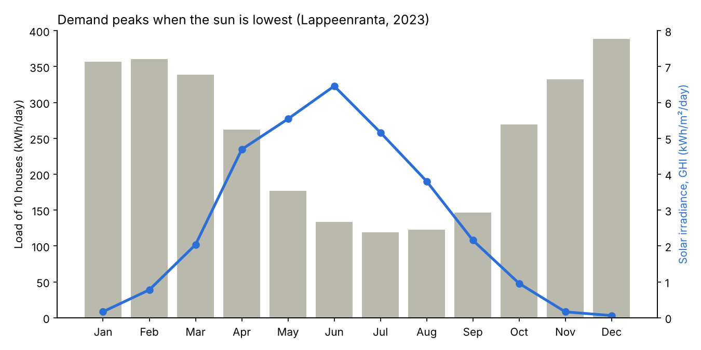
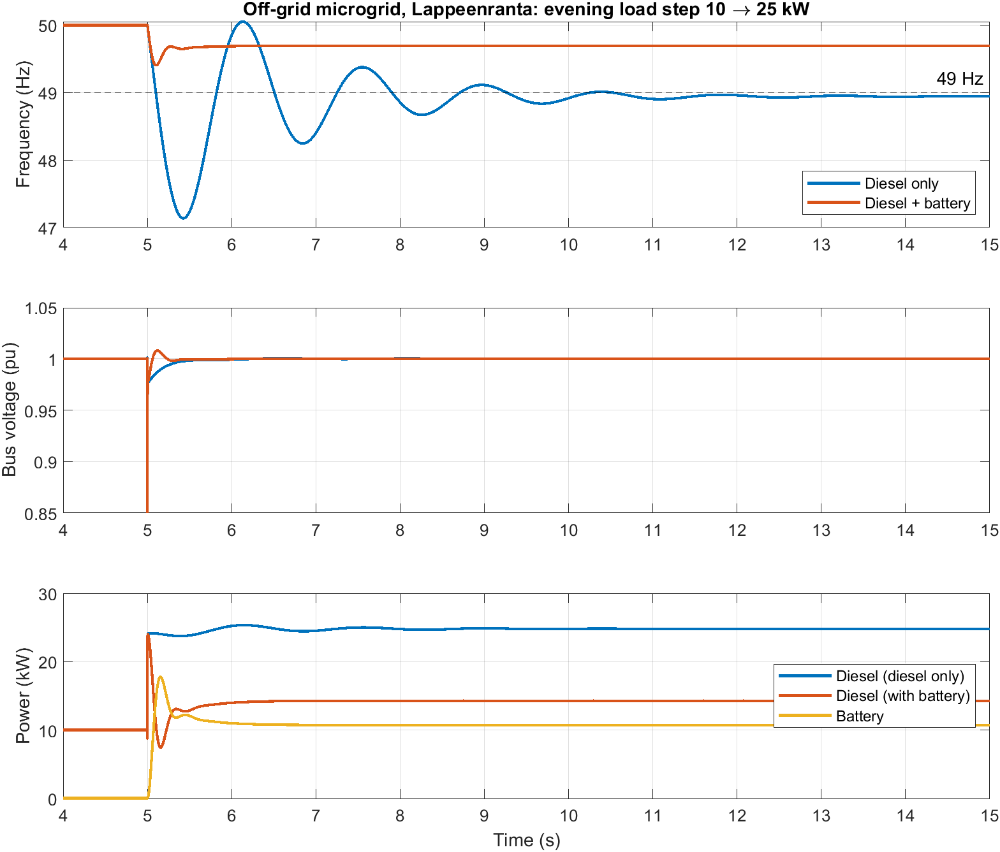

# Energy system modelling in HOMER Pro and MATLAB/Simulink

Hybrid solar and wind supply for ten rural houses in Lappeenranta, Finland. Part 1 compares a grid-connected and an off-grid system on cost and reliability in HOMER Pro. Part 2 simulates how the off-grid system responds to a sudden load step in MATLAB/Simulink.

Weather data is from 2023 and prices are from 2025.

## Key results

| | Grid-connected (Case A) | Off-grid (Case B) |
|---|---|---|
| Optimal system | PV 20.4 kW + 12.7 kW converter + grid | PV 80.8 kW + 28 kW diesel + 200 kWh Li-ion + 18.6 kW converter |
| Net present cost, 25 yr | 213,113 EUR | 860,814 EUR |
| Cost of energy | 0.141 EUR/kWh | 0.599 EUR/kWh |
| Renewable share | 18.9% | 34.2% |
| Payback vs base case | 9.5 yr (vs grid only) | 5.2 yr (vs diesel only) |

- Grid plus PV is about 4 times cheaper per kWh than the best off-grid system.
- Wind never enters an optimal system, even at 4,000 EUR/kW. The mean wind speed is 2.65 m/s at 10 m.
- Off-grid, the battery cuts diesel generator hours from 8,760 to 2,252 a year. No feasible 100% renewable system was found.

**Simulink, 15 kW load step at t = 5 s (10 to 25 kW):**

| | Diesel only | Diesel + battery inverter |
|---|---|---|
| Lowest frequency | 47.14 Hz | 49.40 Hz |
| Steady frequency after step | 48.94 Hz | 49.69 Hz |
| Lowest voltage | 0.977 pu | 0.979 pu |
| Diesel / battery power, steady | 24.8 / 0 kW | 14.3 / 10.7 kW |

The diesel alone would fall below a typical 47.5 Hz under-frequency trip. The battery inverter's 2% frequency droop holds the frequency within 0.6 Hz.

## Repository layout

| Folder | Contents |
|---|---|
| `data/` | Hourly 2023 inputs (8,760 values each): solar GHI, temperature, 10 m wind speed, and the 10-house load profile |
| `homer/` | HOMER Pro project files for both cases, plus every input and cost with its source |
| `simulink/` | `build_offgrid_microgrid.m`, which builds, runs and plots the Simulink model, and the saved `offgrid_microgrid.slx` |
| `results/` | Full HOMER and Simulink results |
| `figures/` | HOMER screenshots, the Simulink model and results plot |

## Method

**Data.** Lappeenranta (61.058 N, 28.186 E, 99 m). Hourly 2023 data from PVGIS 5.3 (SARAH3 radiation, ERA5 weather), shifted to UTC+2.

**Load.** Synthetic, 91.2 MWh/yr (250 kWh/day), 25.1 kW peak. Half is household electricity with morning and evening peaks. Half is heat-pump space heating, proportional to heating degree hours below 17 C. December is 389 kWh/day and July 119 kWh/day.

**HOMER Pro 3.18.4.** The economics are a 6% discount rate, 2% inflation and 25 years.

| Component | Cost |
|---|---|
| PV | 800 EUR/kW |
| Converter | 200 EUR/kW |
| Generic 10 kW wind turbine | 50,000 EUR, with a sensitivity of 0.8 / 1.0 / 1.4 on its price |
| Li-ion battery | 70,000 EUR per 100 kWh |
| Diesel generator | 500 EUR/kW |
| Diesel fuel | 1.69 EUR/L |
| Grid | Buy 0.156 EUR/kWh, sell 0.04 EUR/kWh |

The full list and sources are in [`homer/inputs_and_costs_2025.md`](homer/inputs_and_costs_2025.md).

**Simulink.** MATLAB R2024b with Simscape Electrical (Specialized Power Systems), phasor mode, 50 Hz.

| Part | Model |
|---|---|
| Diesel generator | 28 kW (35 kVA) simplified synchronous machine, H = 1 s |
| Governor | 5% droop (time constants 0.05 s and 0.5 s) |
| Voltage regulator | Integral control |
| Battery inverter | Three-phase dynamic load under external power control, 2% frequency droop, 0.05 s response, 18.6 kW limit |

The model was checked against a hand calculation of the steady frequency drop: 1.07 / 0.31 Hz expected, 1.06 / 0.31 Hz simulated. It was also checked for a flat start-up and for power balance.

## How to reproduce

1. **HOMER:** open the `.homer` files in `homer/` with HOMER Pro 3.18 or newer and press Calculate. To start from scratch, import the files in `data/` under Resources and Electric Load.
2. **Simulink:** open MATLAB with Simscape Electrical installed. Put `build_offgrid_microgrid.m` in a folder and run `build_offgrid_microgrid`. It builds `offgrid_microgrid.slx`, runs both cases (about 2 minutes), prints the results table and saves the plot.

## Limitations

- The load profile is synthetic, not metered.
- The wind turbine and diesel generator prices have no direct Finnish 2025 source.
- HOMER 3.18 would not import hourly temperature, so monthly averages were used.
- The Simulink model covers one load step, without PV variability, battery state of charge or protection.

## Data credit

Solar radiation and weather data: PVGIS © European Union, 2001–2025, JRC (SARAH3, ERA5), used under CC BY 4.0.

## Author

Md Sazzadur Rahman, LUT University.
